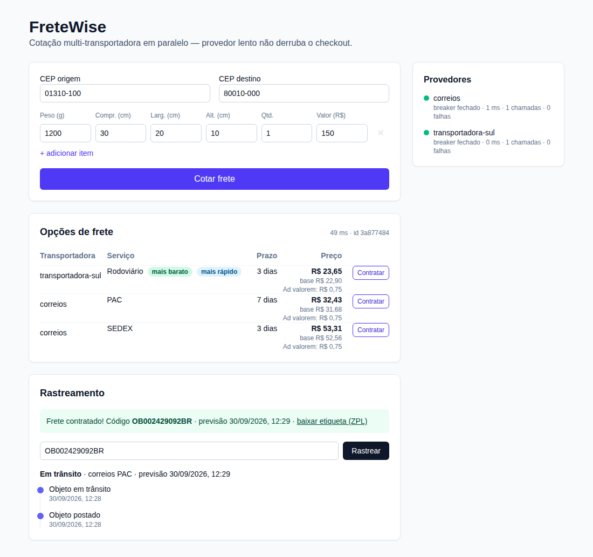
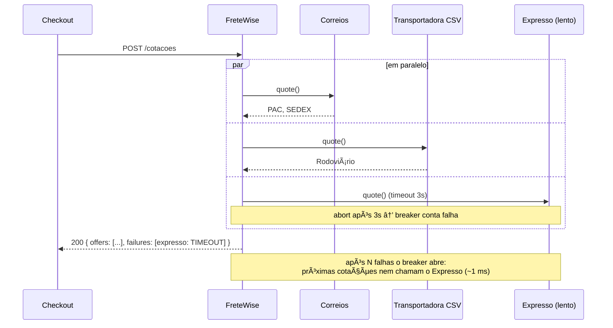

# FreteWise

API de cotação de frete multi-transportadora: consulta provedores **em paralelo**, aplica regras de negócio (peso cubado, taxas, prazo) e devolve as opções ordenadas por preço e prazo — **sem deixar um provedor lento derrubar o checkout**.



## Destaques

- **Resultado parcial**: `Promise.allSettled` + timeout individual. Provedor fora do ar vira item em `failures`, nunca um 500.
- **Circuit breaker próprio** por provedor (fechado → aberto → meio-aberto), visível em `GET /provedores`.
- **Decorators** `withTimeout`, `withBreaker`, `withMetrics` aplicados pelo `ProviderRegistry` — impossível registrar provedor desprotegido.
- **Dinheiro em centavos (inteiro)**, com arredondamento explícito e testado.
- **Regras de precificação** como pipeline de funções puras (`rules.reduce`).
- Config por env validada com Zod no boot, logs pino com `correlationId`, métricas Prometheus em `/metrics`.
- **Persistência em PostgreSQL**: envios e histórico de cotações, com migrations versionadas. Sem Docker, usa Postgres embutido (PGlite) gravando em disco.

## Arquitetura

```
POST /cotacoes
   │
   ▼  Fastify (validação Zod)
QuotationService
   ├── resolve UF dos CEPs (ViaCEP → fallback por faixa de CEP)
   ├── cache (memória ou Redis) por origem+destino+peso arredondado
   ├── Promise.allSettled sobre providers decorados:
   │       metrics( breaker( timeout( provider ) ) )
   │       ├── CorreiosProvider        (tabela simulada, fator 6000)
   │       ├── CsvTableProvider        (tabela CSV, fator 300 kg/m³)
   │       └── ExpressoHttpProvider    (API HTTP, opcional)
   ├── PricingRules: ad valorem → taxa por região → prazo por UF → frete grátis
   └── ordena por preço/prazo, marca "mais barato" e "mais rápido"
```

### Diagrama de sequência (provedor lento)



## Provedores

| Id | Tipo | Fator de cubagem | Observações |
|----|------|------------------|-------------|
| `correios` | Tabela simulada em código | 6000 cm³/kg | PAC e SEDEX, até 30 kg, acréscimo por distância entre regiões |
| `transportadora-sul` | Tabela CSV (`apps/api/data/transportadora-sul.csv`) | 300 kg/m³ | Faixas de peso por UF origem → região destino |
| `expresso` | API HTTP (`EXPRESSO_API_URL`) | 6000 cm³/kg | Habilitado só se a env existir; mapeia reais → centavos |
| ViaCEP | API pública real | — | Resolve UF; se falhar, usa faixa de CEP estática |

## API

### `POST /cotacoes`

```json
{
  "origin": { "cep": "01310-100" },
  "destination": { "cep": "80010-000" },
  "items": [{ "weightGrams": 1200, "lengthCm": 30, "widthCm": 20, "heightCm": 10, "quantity": 1, "valueCents": 15000 }]
}
```

Resposta (valores em centavos):

```json
{
  "correlationId": "…",
  "offers": [
    { "providerId": "transportadora-sul", "service": "Rodoviário", "price": 2365, "deadlineDays": 3,
      "breakdown": { "base": 2290, "fees": [{ "name": "Ad valorem", "value": 75 }] } }
  ],
  "failures": [{ "providerId": "expresso", "code": "TIMEOUT", "reason": "Timeout após 3000ms" }],
  "cheapest": { "providerId": "transportadora-sul", "service": "Rodoviário" },
  "fastest": { "providerId": "transportadora-sul", "service": "Rodoviário" },
  "cached": false
}
```

Códigos de falha: `TIMEOUT`, `CIRCUIT_OPEN`, `UPSTREAM_ERROR`, `INVALID_RESPONSE`, `UNSUPPORTED_ROUTE`.

### Contratação e etiqueta — `POST /envios`

Mesmo corpo da cotação + `providerId`, `service`, `sender` e `recipient` (`name`, `street`, `number`, `complement?`, `city`).
O **preço nunca vem do cliente**: o servidor recota e usa a oferta vigente (422 `OFFER_UNAVAILABLE` se ela não existir mais).
Responde `201` com o envio, o código de rastreio (formato `AA00000000DBR`, com dígito verificador) e os links:

- `GET /envios/:codigo` — dados do envio
- `GET /envios/:codigo/etiqueta` — etiqueta **ZPL** (impressora térmica 10x15 cm) com código de barras, destinatário e remetente

### Rastreamento — `GET /rastreamento/:codigo`

Linha do tempo simulada e determinística, derivada da data de contratação e do prazo:
`POSTADO` → `EM_TRANSITO` (25% do prazo) → `SAIU_PARA_ENTREGA` (90%) → `ENTREGUE` (100%). Eventos do mais recente para o mais antigo.
Use `TRACKING_DAY_MS` para acelerar a simulação em demos (ex.: `60000` = 1 dia vira 1 minuto).

- `GET /envios?limit=20&offset=0` — envios contratados (mais recentes primeiro), paginado

### Histórico de cotações

Toda cotação (inclusive as servidas do cache e as recotações feitas na contratação) é gravada no banco para auditoria e análise de preço/falhas por provedor. A gravação é *best-effort*: se o banco cair, a cotação continua respondendo normalmente.

- `GET /cotacoes?limit=20&offset=0` — histórico paginado
- `GET /cotacoes/:correlationId` — uma cotação específica (ofertas, falhas, duração, se veio do cache)

### Outras rotas
- `GET /provedores` — estado do breaker, latência média, chamadas e falhas.
- `GET /metrics` — formato Prometheus.
- `GET /health` — inclui o estado do banco; responde `503` se o banco estiver fora

Envie `x-correlation-id` para propagar seu id; ele volta no header e no corpo e aparece como `correlationId` em **todos** os logs da requisição (Fastify, service e cada provedor).

## Banco de dados

| Ambiente | Banco | Como |
|----------|-------|------|
| Produção / Docker | PostgreSQL 16 | `DATABASE_URL=postgres://…` (o `docker compose` já configura, com volume `pgdata`) |
| Dev local sem Docker | PGlite (Postgres em WASM) | Padrão quando não há `DATABASE_URL`; grava em `apps/api/data/pgdata` (ignorado pelo git) |
| Testes | PGlite em memória + PostgreSQL real no CI | `PGLITE_DATA_DIR=memory`; `TEST_DATABASE_URL` ativa os testes contra Postgres |

O mesmo SQL roda nos dois. As migrations (`apps/api/src/infra/db/migrations.ts`) são aplicadas automaticamente no boot, em transação, e registradas em `schema_migrations`. Nunca edite uma migration já publicada — crie uma nova versão.

Tabelas:
- `shipments` — envios contratados (preço em centavos `BIGINT`, endereços/itens/breakdown em `JSONB`), código de rastreio como chave e sequência `shipment_seq` para gerar códigos sem colisão entre reinícios.
- `quotations` — histórico de cotações por `correlation_id`.

## Regras de negócio (padrão)

| Regra | Valor |
|-------|-------|
| Ad valorem | 0,5% do valor declarado |
| Taxa por região | +15% Norte, +8% Nordeste |
| Prazo adicional | AM/RR/AP +3, AC/RO +2, PA +1 dias |
| Frete grátis | pedidos ≥ `FREE_SHIPPING_THRESHOLD_CENTS` (R$ 500) nos serviços econômicos |

## Desempenho

Script: `pnpm --filter @frete-wise/api load` — gerador **open-loop** (dispara a cada 10 ms sem esperar respostas) a **100 req/s por 15 s**, com o provedor `expresso` **travado** (nunca responde) e timeout de 3 s.

| Métrica | Resultado |
|---------|-----------|
| Requisições | 1500 (0 erros, 0 não-2xx) |
| p50 | 1 ms |
| **p95** | **3003 ms** (requisito: < 3500 ms) |
| p99 | 3005 ms |

As requisições dos primeiros ~3 s esperam o timeout; assim que o breaker abre, as seguintes respondem em ~1 ms sem consultar o provedor travado.

## Executando

```bash
pnpm install
cp .env.example .env         # opcional
pnpm dev:api                  # http://localhost:3000
pnpm dev:web                  # http://localhost:5173 (proxy /api → :3000)
pnpm test                     # testes da API e do front
pnpm coverage                 # cobertura da API e do front (mínimo 85% cada)
cp .env.example .env && docker compose up   # API + PostgreSQL + Redis (defina POSTGRES_PASSWORD no .env)
```

## Testes

- **Unitários**: Money (sem erro de float), peso cubado (volume enorme, peso zero), regras, breaker com timers falsos, cache, decorators.
- **Contrato**: cada adapter valida resposta bruta → `Offer` com fixture gravada.
- **Banco**: dados sobrevivem a reinício (PGlite em disco), migrations idempotentes, rollback de transação, banco fora do ar não derruba a cotação, e o fluxo completo contra **PostgreSQL real** no CI.
- **Integração**: contratação com recotação no servidor, etiqueta ZPL, rastreamento avançando no tempo, 404/422/400, logs com `correlationId`.
- **Integração** (MSW): sucesso, lentidão acima do timeout, 500, resposta malformada, erro de rede, breaker abrindo, ViaCEP fora do ar, cache.
- Cobertura atual da API: ~99% de linhas.

### Front (`apps/web`)

Vitest + jsdom + Testing Library, com `fetch` mockado:

- **QuoteForm**: envio de CEPs e itens (conversão de reais para centavos), adicionar/remover itens, estado de carregamento.
- **OfferTable**: ordem das ofertas, badges "mais barato"/"mais rápido", breakdown de taxas, "Grátis", aviso de resultado parcial, cache e rota sem ofertas.
- **ProviderStatus**: estados do breaker (fechado/aberto/meio-aberto), API indisponível, polling a cada 5 s e recarga ao cotar.
- **ContractForm / TrackingPanel**: dados de remetente e destinatário, link da etiqueta, linha do tempo, busca por código e erros.
- **App**: fluxo completo de cotação → contratação → rastreamento, erro de validação vindo da API e falha de rede.
- **api.ts**: cliente HTTP e formatação em BRL.
- Cobertura atual do front: ~98% de linhas.

## Estrutura

```
apps/api/src
├── domain/     money, package (peso cubado), quote, regions, errors
├── providers/  correios, csv-table, expresso-http, decorators/, registry
├── services/   quotation.service, pricing-rules, shipment.service, label (ZPL)
├── infra/      breaker, cache, http, cep-resolver, logger, db/ (conexão + migrations), shipment-store, quotation-store
└── routes/     cotacoes, envios, provedores, health
apps/web/src    App, components/QuoteForm, OfferTable, ContractForm, TrackingPanel, ShipmentHistory, ProviderStatus
```

## Pré-requisitos

- Node.js 22+
- pnpm 10+ (`corepack enable`)
- Docker (opcional, para Redis)

## Variáveis de ambiente

Veja `.env.example`. Todas têm valor padrão e são validadas no boot — um valor inválido derruba a aplicação na inicialização com mensagem clara.

| Variável | Padrão | Descrição |
|----------|--------|-----------|
| `PORT` | 3000 | Porta HTTP |
| `LOG_LEVEL` | info | Nível de log pino |
| `PROVIDER_TIMEOUT_MS` | 3000 | Timeout individual por provedor |
| `BREAKER_FAILURE_THRESHOLD` | 5 | Falhas consecutivas para abrir o breaker |
| `BREAKER_RESET_MS` | 30000 | Tempo aberto antes de ir para meio-aberto |
| `CACHE_TTL_MS` | 300000 | TTL do cache de cotação (0 desliga) |
| `REDIS_URL` | — | Usa Redis como cache; sem ela, cache em memória |
| `CEP_API_URL` | ViaCEP | API de CEP |
| `EXPRESSO_API_URL` | — | Habilita o provedor HTTP `expresso` |
| `FREE_SHIPPING_THRESHOLD_CENTS` | 50000 | Valor mínimo do pedido para frete grátis |
| `TRACKING_DAY_MS` | 86400000 | Duração simulada de 1 dia no rastreamento |
| `DATABASE_URL` | — | PostgreSQL; sem ela usa PGlite |
| `PGLITE_DATA_DIR` | `./data/pgdata` | Pasta do PGlite (`memory` = sem persistência) |
| `POSTGRES_USER` / `POSTGRES_PASSWORD` / `POSTGRES_DB` | — | Usadas pelo `docker compose`; defina a senha no seu `.env` |

Nunca versione `.env` — o `.gitignore` já bloqueia `.env*` (exceto `.env.example`), chaves e certificados.

## Como adicionar um provedor

1. Crie uma classe que implemente `ShippingProvider` (`id`, `cubicFactor`, `quote()`), em `apps/api/src/providers/`.
2. Registre-a em `defaultProviders()` (`apps/api/src/container.ts`).
3. Timeout, circuit breaker e métricas são aplicados automaticamente pelo `ProviderRegistry` — o service não muda.
4. Adicione um teste de contrato com uma fixture da resposta bruta.

## Limitações conhecidas
- Contratação e rastreamento são **simulados** (não chamam APIs reais de transportadoras); os dados ficam salvos no banco.

## Licença

Distribuído sob a licença [MIT](LICENSE).


## Licença

### Uso Pessoal
Este projeto é licenciado sob a **Licença MIT** para uso pessoal, educacional e não comercial.

### Uso Comercial
Se você deseja usar este projeto comercialmente, deve obter uma licença comercial do autor.

**Uso comercial inclui:**
- Incorporar em um produto comercial
- Oferecer como serviço
- Usar em atividades com fins lucrativos
- Implantação empresarial

**Para obter uma licença comercial:**
Email: ma.polli@hotmail.com
